# Advanced Web Programming (*Napredno web programiranje*)

[](https://www.ferit.unios.hr/)
[](https://www.ferit.unios.hr/)
[](https://www.unios.hr/)
[](https://www.php.net/)
[](https://laravel.com/)
[](https://www.mysql.com/)

This repository contains the complete laboratory exercise solutions, execution logs, and output verifications submitted by Erasmus+ exchange student **Ahmet Alper Erdoğan** for the **Advanced Web Programming (*Napredno web programiranje*)** course at **FERIT Osijek** (Josip Juraj Strossmayer University of Osijek).

---

## 🏛️ Course & Student Information

* **Institution:** Faculty of Electrical Engineering, Computer Science and Information Technology Osijek ([FERIT](https://www.ferit.unios.hr/))
* **University:** Josip Juraj Strossmayer University of Osijek (*UNIOS*)
* **Course:** Advanced Web Programming (*Napredno web programiranje*)
* **Course Professor:** **prof. dr. sc. Ivica Lukić** ([`ivica.lukic@ferit.hr`](mailto:ivica.lukic@ferit.hr))
* **Teaching Assistants:**
  * **Dina Šabanović** ([`dina.sabanovic@ferit.hr`](mailto:dina.sabanovic@ferit.hr))
  * **Tea Krčmar, univ. mag. ing. comp.** ([`tea.krcmar@ferit.hr`](mailto:tea.krcmar@ferit.hr))
* **Student:** **Ahmet Alper Erdoğan** (Erasmus+ Exchange Student)
* **Contact E-mail:** [`ahmetalpererdogan@gmail.com`](mailto:ahmetalpererdogan@gmail.com)
* **GitHub Repository:** [ahmetalperx/unios_ferit_advanced_web_programming](https://github.com/ahmetalperx/unios_ferit_advanced_web_programming)

---

## 📁 Course Obligations & Official Resources

According to the consultative course requirements, obligations comprise solving **3 Laboratory Exercises** followed by an independent **Final Laravel Project**:

* 📄 **Laboratory Exercises Specification:** [3 Laboratory Exercises (Google Drive)](https://drive.google.com/file/d/13oNo3z0Bn2QuC5-9ek_jQVM88ROEMUNx/view)
* 📂 **Reference Examples Folder:** [Examples Drive Repository](https://drive.google.com/open?id=1z3IXwFWSjsvIC5-VUWoniDm6_Y9m9u3h)
* 📚 **Recommended Course Literature & Books:** [Online Books (Google Drive)](https://drive.google.com/open?id=1xcnWNNsogNkjBT3gy-_QhJyXq0V5pf_0)
* 📖 **Object-Oriented PHP References:**
  * [TutorialsPoint - PHP Object Oriented](https://www.tutorialspoint.com/php/php_object_oriented.htm)
  * [W3Schools - PHP OOP Fundamentals](https://www.w3schools.com/php/php_oop_what_is.asp)
  * [PHP Tutorial - Object-Oriented PHP Guide](https://www.phptutorial.net/php-oop/)
* 🚀 **Laravel Documentation & Tutorials:**
  * [Laravel Official Documentation (Installation & Architecture)](https://laravel.com/docs/12.x/installation)
  * [MageComp - CRUD Operations in Laravel](https://magecomp.com/blog/crud-operation-laravel-8/)
  * [ItSolutionStuff - Laravel CRUD Application Tutorial](https://www.itsolutionstuff.com/post/laravel-9-crud-application-tutorial-exampleexample.html?utm_content=cmp-true)
  * [AppDividend - Laravel CRUD Step-by-Step](https://appdividend.com/2022/01/26/laravel-8-crud/)

---

## 📚 Laboratory Exercises Summary

| Exercise | Module / Focus | Description | Technologies |
| :--- | :--- | :--- | :--- |
| **Exercise 1** | OOP Web Scraper & DB | Web scraper fetching graduate theses from FERIT endpoints and persisting them via OOP interface to MySQL. | PHP 8.3 OOP, cURL, MySQL (PDO) |
| **Exercise 2 (Task 1)** | Database Backup & Zip | Dynamic CLI backup tool generating formatted SQL dumps and compressing into `.zip`. | PHP CLI, PDO, ZipArchive |
| **Exercise 2 (Task 2)** | XML Parsing & Profiles | XML dataset parser (`LV2.xml`) rendering responsive profile cards with SVG fallback. | SimpleXML, HTML5, CSS3 Glassmorphism |
| **Exercise 2 (Task 3)** | Cryptography Vault | Secure document upload and decryption vault using AES-256-CBC. | OpenSSL, AES-256-CBC, Multipart Upload |
| **Exercise 3** | Laravel Project Platform | Full-featured collaborative project management application with role permissions & multi-language localization. | Laravel 12.x, Blade, Tailwind CSS, MySQL |

---

## 🔍 Detailed Exercise Breakdown

### 📘 Exercise 1: OOP Thesis Scraper & Persistence
* **Location:** [`exercise_1/task_1/index.php`](exercise_1/task_1/index.php)
* **Features:**
  * Defines and implements `iRadio` interface (`create($data)`, `save()`, `read()`).
  * Connects to `https://stup.ferit.hr/zavrsni-radovi/page/$number/` (pages 2 to 6) using cURL.
  * Parses thesis title, content snippet, link, and identification number.
  * Saves parsed records into the MySQL `thesis` database (`graduate_theses` table) with fluent method chaining (`$thesis -> create($data) -> save()`).
  * Retrieves and displays all persisted records with structured verification status.

#### 🖥️ Scraper Execution Console Output
```text
// ---------------------------------------------------------------------------------------------- //
[ INFO ] | database 'thesis' and table 'graduate_theses' created
// ---------------------------------------------------------------------------------------------- //
[ URL ] | https://stup.ferit.hr/zavrsni-radovi/page/2
[ THESIS 1 ] | Abbrevio – web aplikacija za skraćenice | 76381967583
[ THESIS 2 ] | Aplikacija za spajanje pasa i budućih vlasnika | 47726994562
[ THESIS 3 ] | Web aplikacija za vođenje podataka o udomljenim psima u azilu | 47726994562
[ THESIS 4 ] | Web aplikacija kao platforma za postavljanje i korištenje kvizova | 52685771113
[ THESIS 5 ] | Izrada web oglasnika za usluge obavljanja poslova u kućanstvu | 52685771113
[ THESIS 6 ] | Izrada Shopify web trgovine namijenjene proizvođaču poljoprivrednih proizvoda | 52685771113
...
```

---

### 📗 Exercise 2: Advanced Data Manipulation, Parsing & Security

#### Task 1: Dynamic Database Backup & Compression
* **Location:** [`exercise_2/task_1/index.php`](exercise_2/task_1/index.php)
* **Features:**
  * Accepts any database name dynamically as a command-line argument (`$argv[1]`).
  * Introspects table structures via `SHOW TABLES` and column metadata via `SHOW COLUMNS`.
  * Exports formatted SQL `INSERT INTO ... VALUES (...)` statements to `.txt`.
  * Automatically creates a compressed `.zip` archive using PHP's native `ZipArchive`.

#### 🖥️ CLI Backup Console Output
```text
// ---------------------------------------------------------------------------------------------- //
[ INFO ] | thesis_backup.txt file created
[ INFO ] | thesis_backup.zip file created
// ---------------------------------------------------------------------------------------------- //
```

#### Task 2: XML Data Extraction & Responsive Profile Cards
* **Location:** [`exercise_2/task_2/index.php`](exercise_2/task_2/index.php)
* **Features:**
  * Parses `LV2.xml` containing 100 person records (ID, first name, last name, email, gender, picture URL, resume).
  * Displays modern glassmorphism profile cards.
  * Incorporates an inline dynamic SVG initials avatar fallback in case remote avatar links fail.

<p align="center">
  
</p>

#### Task 3: Secure Document Encryption & Decryption Vault
* **Location:** [`exercise_2/task_3/index.php`](exercise_2/task_3/index.php)
* **Features:**
  * Allows uploading documents or images (PDF, JPEG, PNG).
  * Encrypts files using modern OpenSSL (`AES-256-CBC` cipher with secure IV generation), serving as a modern and secure replacement for deprecated Mcrypt in PHP 8.3+.
  * Stores strictly encrypted payloads (`.enc`) on the server.
  * Lists uploaded documents and provides on-the-fly decryption and download links.

<p align="center">
  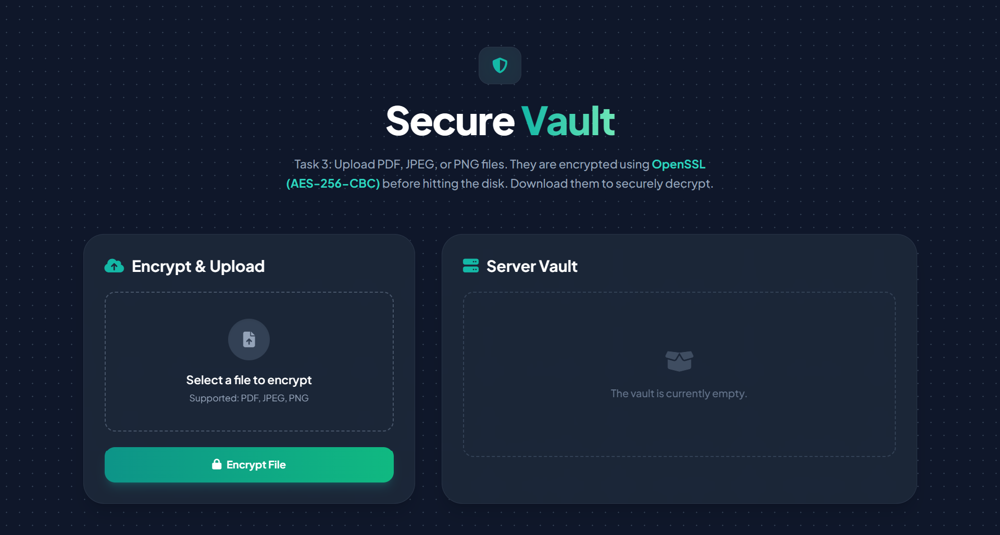
  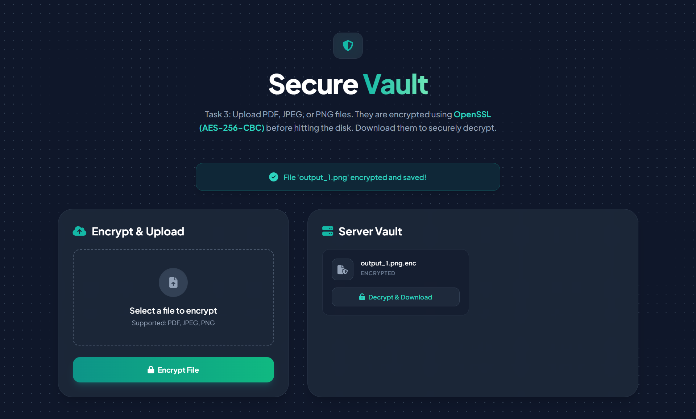
</p>

---

### 📙 Exercise 3: Collaborative Project Management System (Laravel)

* **Location:** [`exercise_3/projects/`](exercise_3/projects/)
* **Architecture:** Minimalist, clean Laravel application without extraneous framework bloat.

#### Task 1: Project Management & Permissions
* **Authentication:** User registration (`/register`), login (`/login`), and logout (`/logout`) using clean controller actions.
* **Database Models & Migrations:**
  * `projects` table: `name`, `description`, `price`, `done_jobs`, `start_date`, `end_date`, `manager_id`.
  * `project_user` pivot table supporting many-to-many team member assignments.
* **Two-Section Profile Dashboard:**
  1. **Projects Managed by Me:** Displays all projects opened and managed by the authenticated user.
  2. **Projects Where I Am a Team Member:** Displays all projects where the authenticated user is assigned as a collaborator.
* **Strict Role-Based Permission Control:**
  * **Project Manager:** Full access to edit all project fields and team members.
  * **Team Members:** Strictly restricted to updating only the completed jobs (`done_jobs`) attribute; all other fields are locked with `disabled`/`readonly` attributes and backend validation safeguards.

#### Task 2: Multi-Language Localization
* **Languages Supported:**
  * 🇬🇧 **English (EN)**
  * 🇵🇱 **Polish (PL)**
  * 🇹🇷 **Turkish (TR)** (added extension)
* **Session-Based Switcher:** Immediate one-click language switching via [`LanguageController`](exercise_3/projects/app/Http/Controllers/LanguageController.php) and custom global [`SetLocale`](exercise_3/projects/app/Http/Middleware/SetLocale.php) middleware.
* **Full Dictionary Coverage:** Complete UI strings, buttons, badges, descriptions, flash notices, and form validation error messages are fully localized in [`lang/en.json`](exercise_3/projects/lang/en.json), [`lang/pl.json`](exercise_3/projects/lang/pl.json), and [`lang/tr.json`](exercise_3/projects/lang/tr.json).

#### 📸 Visual Walkthrough & Execution Screenshots

##### 1. Two-Tier Collaborative Dashboard (Managed vs. Team Member Projects)
* 🇬🇧 **English (EN):**
<p align="center">
  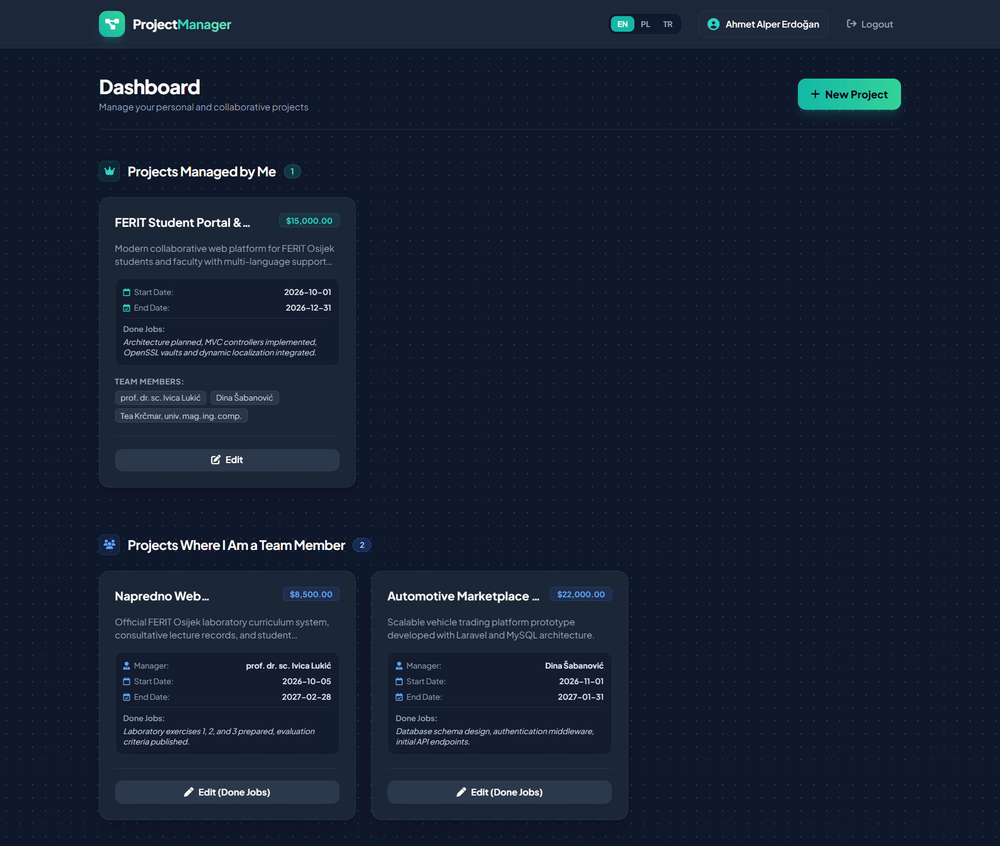
</p>

* 🇵🇱 **Polish (PL) & 🇹🇷 Turkish (TR) Localized Dashboards:**
<p align="center">
  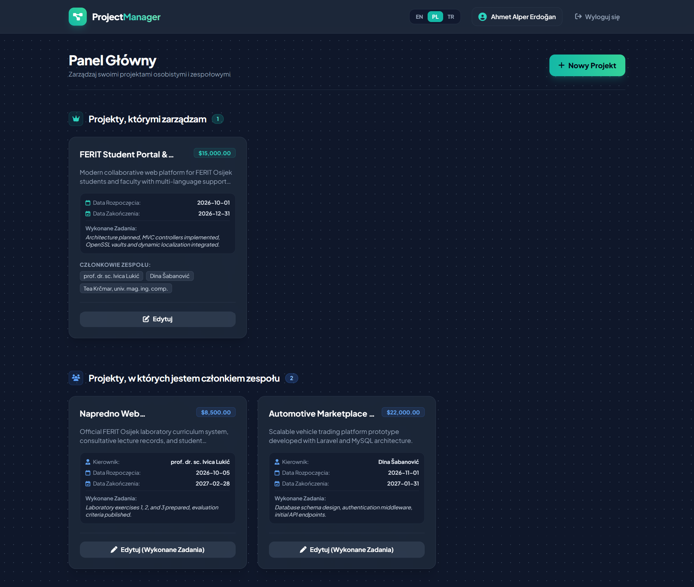
  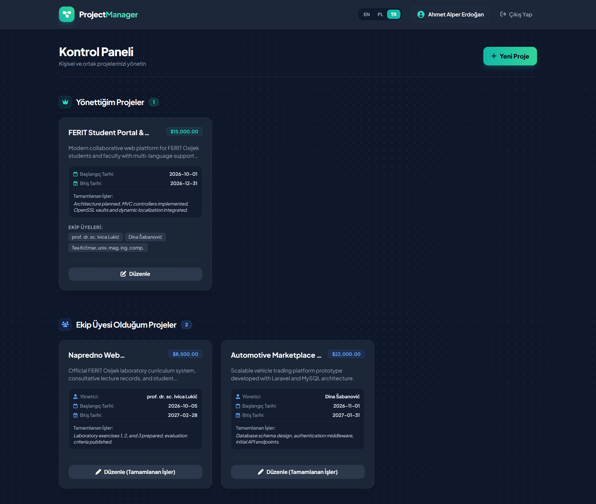
</p>

##### 2. Multi-Language Interface (English, Polish, Turkish)
Full dictionary and interface localization tested across three languages:
<p align="center">
  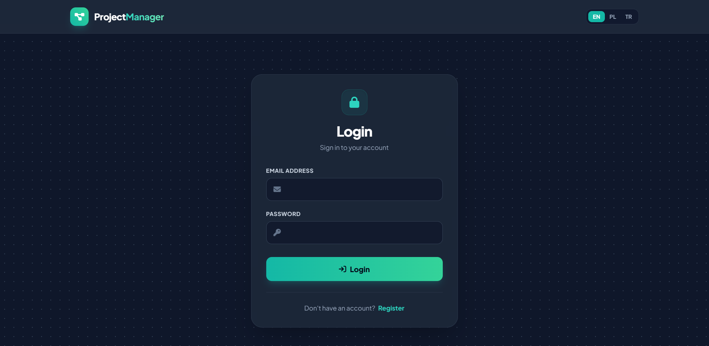
  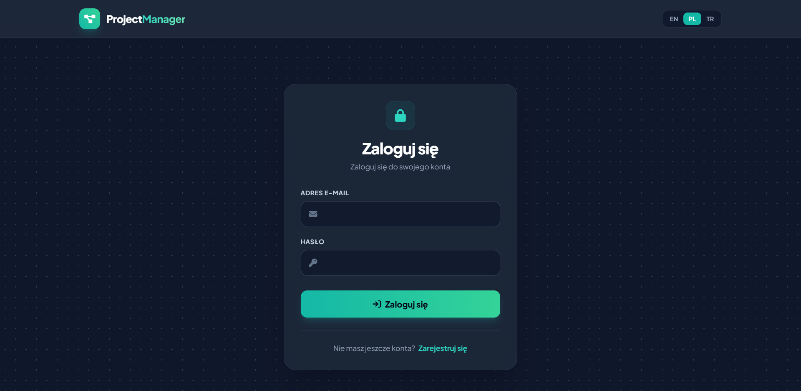
  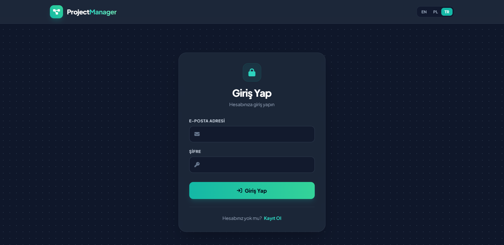
</p>

##### 3. Role-Based Permission Control (Editing Restricted for Team Members)
Form inputs locked with `disabled`/`readonly` attributes for team members, allowing only `done_jobs` updates:

* 🇬🇧 **English (EN):**
<p align="center">
  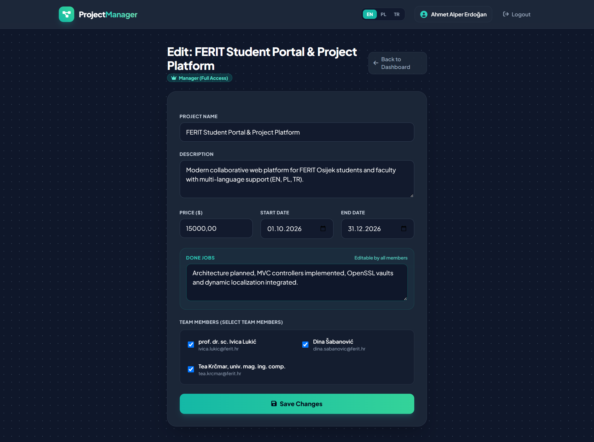
</p>

* 🇵🇱 **Polish (PL) & 🇹🇷 Turkish (TR) Localized Edit Forms:**
<p align="center">
  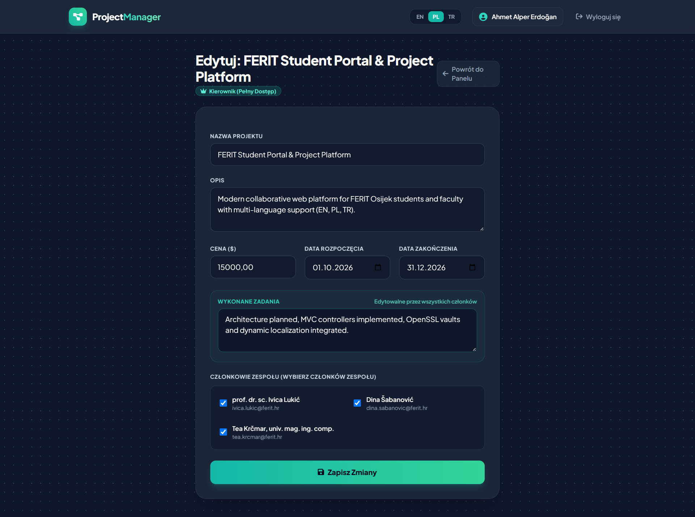
  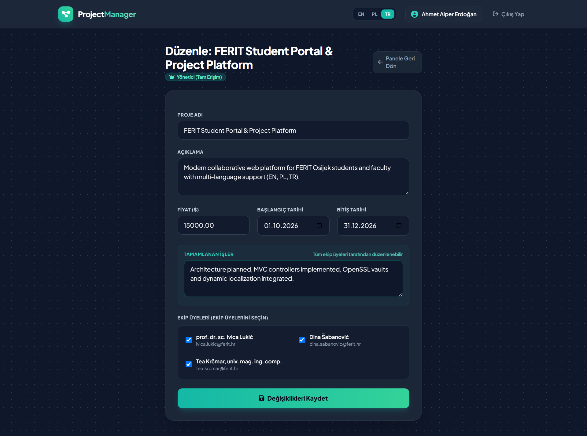
</p>

##### 4. Project Creation & Localized Validation

* 🇬🇧 **English (EN):**
<p align="center">
  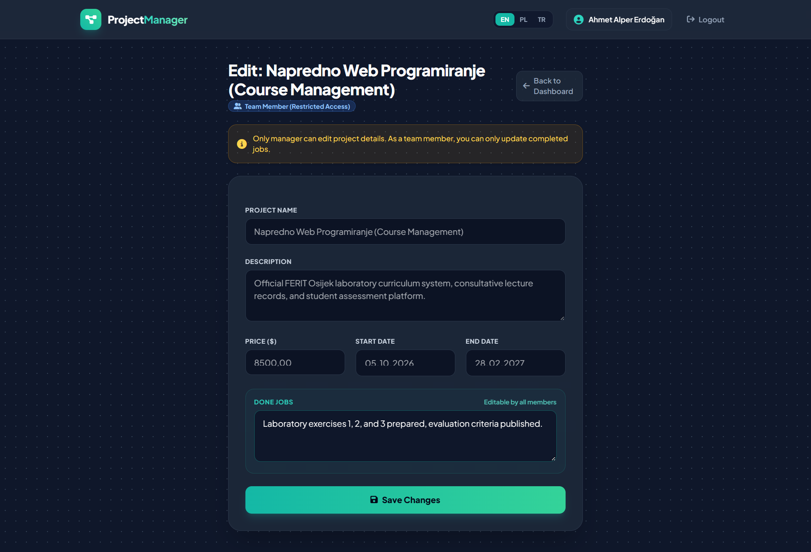
</p>

* 🇵🇱 **Polish (PL) & 🇹🇷 Turkish (TR) Localized Creation Forms:**
<p align="center">
  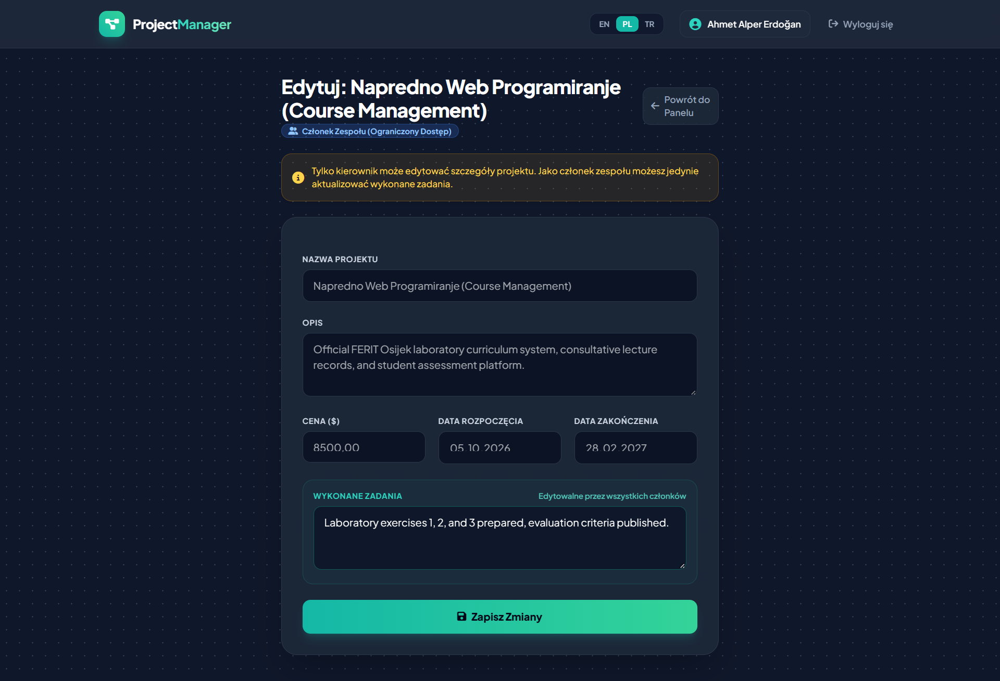
  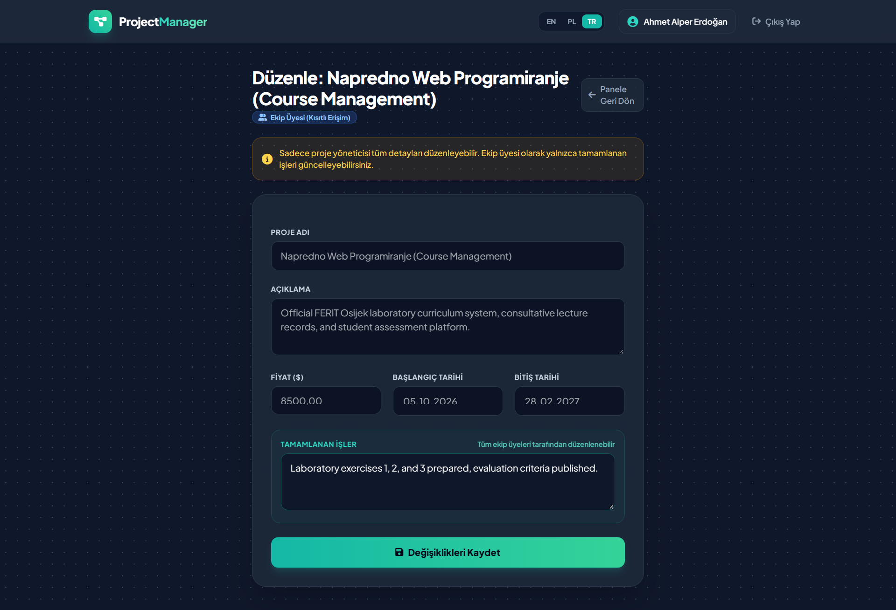
</p>

---

#### 👥 Seeded Teaching Staff & Demo Accounts
All accounts are pre-seeded with the password: `password123`

| Name | Role | Email | Seeded Project |
| :--- | :--- | :--- | :--- |
| **Ahmet Alper Erdoğan** | Student / Manager | `alper@ferit.hr` | *FERIT Student Portal & Project Platform* (Manager) |
| **prof. dr. sc. Ivica Lukić** | Course Professor | `ivica.lukic@ferit.hr` | *Napredno Web Programiranje (Course Management)* (Manager) |
| **Dina Šabanović** | Teaching Assistant | `dina.sabanovic@ferit.hr` | *Collaborative Academic Platform* (Manager) |
| **Tea Krčmar, univ. mag. ing. comp.** | Junior Researcher | `tea.krcmar@ferit.hr` | Team Member on collaborative projects |

---

## 🎯 Final Course Project (Course Requirement)

As instructed by Prof. dr. sc. Ivica Lukić:
> *"After You solve the Laboratory Exercises You should make a Laravel project (project theme is by your choice) and present it to me to pass a course."*

* **Status:** Project topic to be chosen and submitted for the professor's approval following the review and evaluation of the 3 Laboratory Exercises.

---

## 🚀 Local Setup & Installation

### Prerequisites
* **PHP:** `8.3.x` with `pdo_mysql`, `curl`, `openssl`, `zip`, `mbstring` extensions enabled.
* **Web Server:** Laragon WAMP / Apache / Nginx.
* **Database:** MySQL 5.7+ / 8.0+.
* **Composer:** 2.x+.

### 1. Database Configuration
Ensure MySQL is running on `127.0.0.1:3306` with user `root` (no password). Create databases if needed:
```sql
CREATE DATABASE thesis CHARACTER SET utf8mb4 COLLATE utf8mb4_unicode_ci;
CREATE DATABASE projects_db CHARACTER SET utf8mb4 COLLATE utf8mb4_unicode_ci;
```

### 2. Running Exercise 1 & 2
```powershell
# Run Exercise 1 Thesis Scraper
php exercise_1/task_1/index.php

# Run Exercise 2 Task 1 (Database Backup to .txt and .zip)
php exercise_2/task_1/index.php thesis

# Run Exercise 2 Task 2 & Task 3 (via local web server or Laragon)
# Accessible via: http://localhost/advanced_web_programming/exercise_2/task_2/index.php
# Accessible via: http://localhost/advanced_web_programming/exercise_2/task_3/index.php
```

### 3. Running Exercise 3 (Laravel)
```powershell
cd exercise_3/projects

# Copy environment configuration
cp .env.example .env

# Install dependencies (if needed)
composer install

# Generate application encryption key
php artisan key:generate

# Run database migrations and seed official teaching staff
php artisan migrate --seed

# Launch local development server
php artisan serve
```

Visit [`http://localhost:8000`](http://localhost:8000) in your web browser.

---

## 📬 Contact & Inquiries

* **Student:** Ahmet Alper Erdoğan ([`ahmetalpererdogan@gmail.com`](mailto:ahmetalpererdogan@gmail.com))
* **Faculty:** Faculty of Electrical Engineering, Computer Science and Information Technology Osijek (FERIT)
* **University:** Josip Juraj Strossmayer University of Osijek, Croatia
